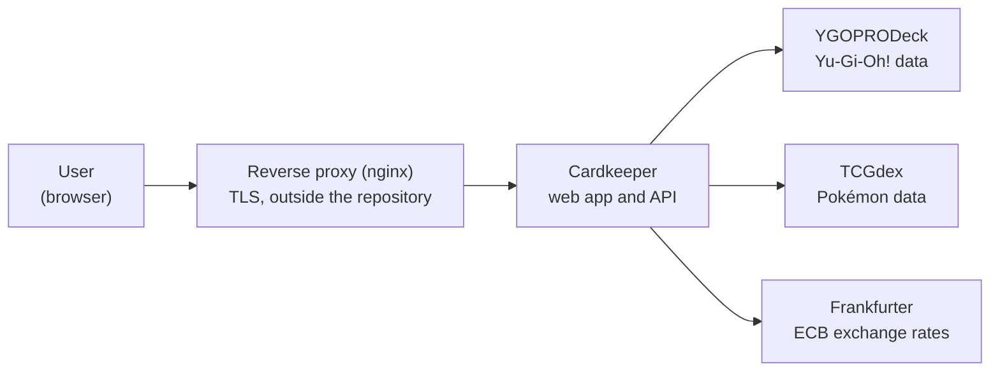
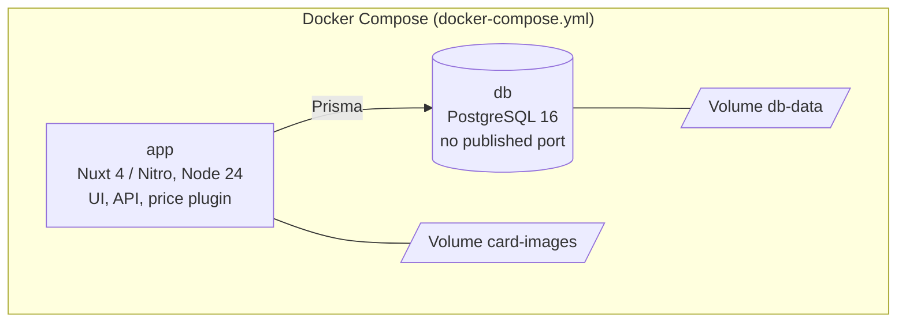
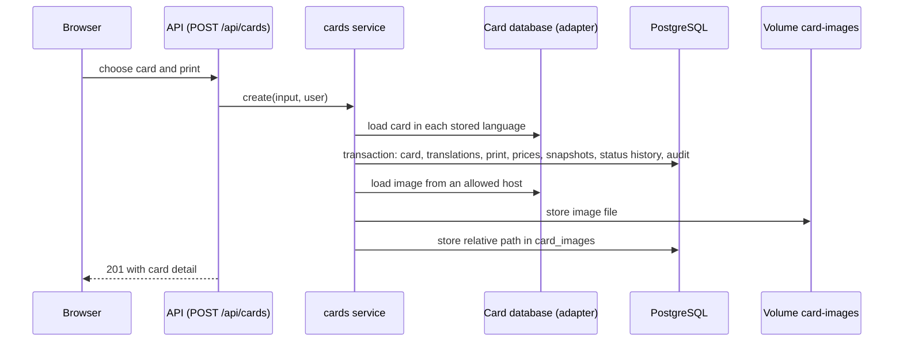
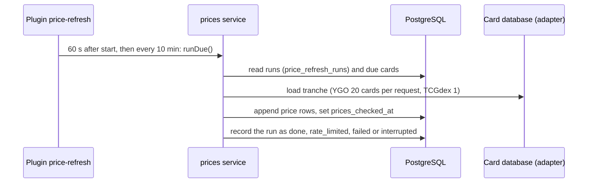
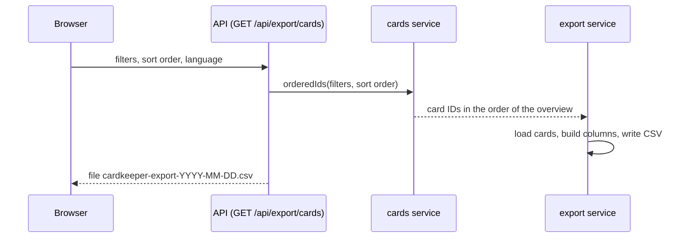

# Architecture

Short overview in the style of C4 (context, containers, building blocks) with three runtime flows. The decisions are in `docs/adr/`, the requirements in `openspec/specs/`; this file does not repeat them but links to them. Every statement comes from `README.md` (7f3d955) §Architecture, `docker-compose.yml` or the code under `app/`.

## 1. System context

- The reverse proxy terminates TLS and only forwards; the app does the login itself ([ADR 0008](adr/0008-own-login-sealed-cookie.md), [ADR 0001](adr/0001-hosting-self-hosted.md)).
- Card data: [ADR 0023](adr/0023-card-data-sources-ygoprodeck-tcgdex.md). Rates: [ADR 0012](adr/0012-prices-in-source-currency.md).

## 2. Containers

- Two services, two volumes; the port of the app is bound to `127.0.0.1` by default. Details: spec [`operations`](../openspec/specs/operations/spec.md).
- The price reload runs as a plugin in the app process, not as a separate container ([ADR 0007](adr/0007-price-scheduler-in-app-process.md)).
- The image is multi-arch ([ADR 0016](adr/0016-multi-arch-image-native-build.md)).

## 3. Building blocks of the app (`app/`)

| Building block | Directory | Purpose | Spec |
|---|---|---|---|
| Interface | `app/app/` (pages, components, composables, layouts, middleware) | Vue pages, dialogs, remembered state | [`overview`](../openspec/specs/overview/spec.md), [`card-detail`](../openspec/specs/card-detail/spec.md), [`user-interface`](../openspec/specs/user-interface/spec.md) |
| Translations | `app/i18n/locales/` | German and English | [`user-interface`](../openspec/specs/user-interface/spec.md) |
| HTTP layer | `app/server/api/`, `app/server/middleware/` | thin handlers, login requirement, cross-site protection | [`users-access`](../openspec/specs/users-access/spec.md), [`security`](../openspec/specs/security/spec.md) |
| Services | `app/server/services/` | business logic: cards, images, prices, rates, export, users, set catalog | per topic spec |
| Game adapters | `app/server/tcg/` | interface, registry, YGOPRODeck and TCGdex adapters | [`game-adapters`](../openspec/specs/game-adapters/spec.md) |
| Helpers | `app/server/lib/` | configuration, filters, sorting, status, CSV, session, password | [`operations`](../openspec/specs/operations/spec.md) |
| Plugins | `app/server/plugins/` | price reload, edition startup check, create users, shutdown | [`prices`](../openspec/specs/prices/spec.md), [`data-storage`](../openspec/specs/data-storage/spec.md) |
| Shared code | `app/shared/` | types and rules for server and interface | – |
| Data model | `app/prisma/` | schema and migrations | [`data-storage`](../openspec/specs/data-storage/spec.md) |

The services are framework-independent factories with injected dependencies (database, registry, configuration, `fetch`, clock); the Nitro layer is thin ([ADR 0002](adr/0002-nuxt-vue-nitro-single-codebase.md)). A new game is one more adapter in `app/server/tcg/registry.ts` ([ADR 0004](adr/0004-adapter-pattern-per-game.md)).

## 4. Runtime flows

### 4.1 Creating a card

Specs: [`card-entry`](../openspec/specs/card-entry/spec.md), [`images`](../openspec/specs/images/spec.md), [`data-storage`](../openspec/specs/data-storage/spec.md). A failed image download does not prevent creating the card.

### 4.2 Price reload

Specs: [`prices`](../openspec/specs/prices/spec.md), [ADR 0007](adr/0007-price-scheduler-in-app-process.md).

### 4.3 CSV export

Specs: [`export`](../openspec/specs/export/spec.md), [ADR 0013](adr/0013-csv-export-server-side.md), [ADR 0014](adr/0014-overview-filtering-in-memory.md).

## 5. Cross-cutting topics

| Topic | Where |
|---|---|
| Sign-in, rights | [`users-access`](../openspec/specs/users-access/spec.md), ADR 0008, 0009 |
| Headers, cross-site protection | [`security`](../openspec/specs/security/spec.md), ADR 0021 |
| Languages | [`user-interface`](../openspec/specs/user-interface/spec.md), ADR 0006 |
| Currency | [`currency-conversion`](../openspec/specs/currency-conversion/spec.md), ADR 0012 |
| Remembered state | ADR 0020 |
| Operations, configuration | [`operations`](../openspec/specs/operations/spec.md), `README.md` §Configuration |
| Development, releases | [`development-release`](../openspec/specs/development-release/spec.md), ADR 0015, 0018 |

## 6. Maintenance

This file is meant as an overview. It changes only when a building block, a container or an external service is added or removed; in that case an ADR (`docs/adr/`) and the update of this file belong in the same pull request.
