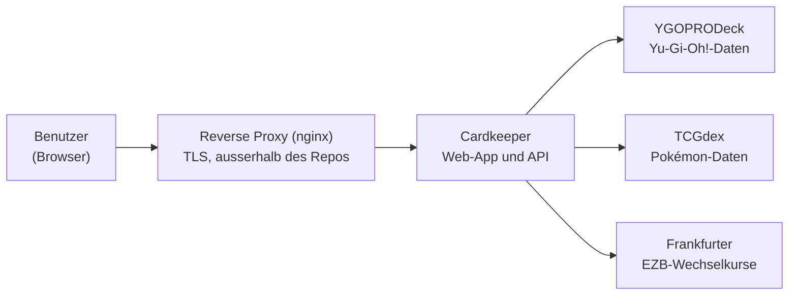
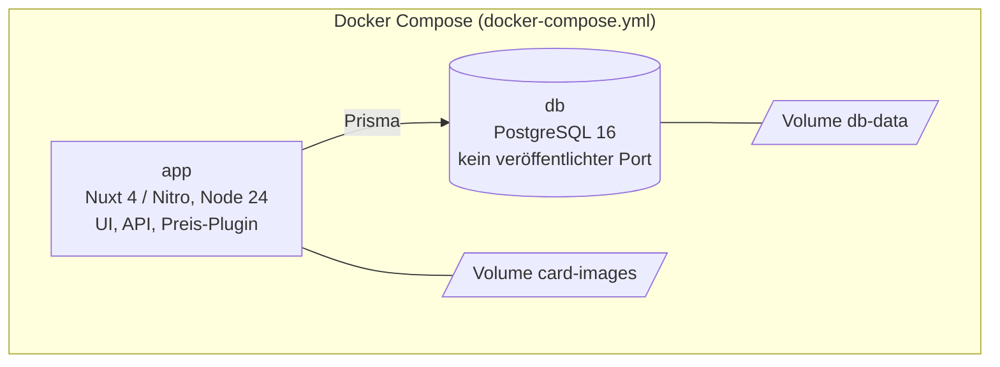
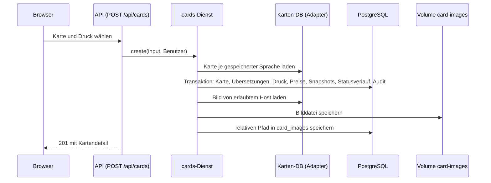
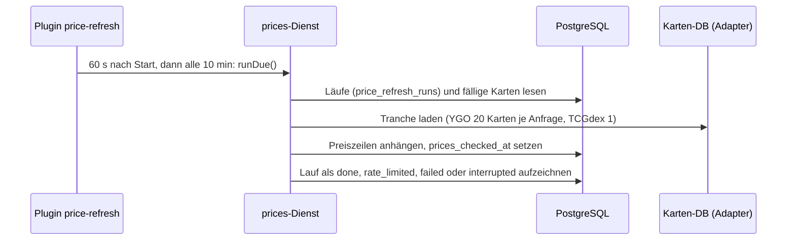
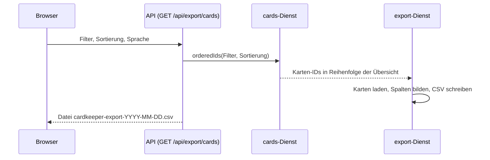

# Architektur

Kurzüberblick nach C4 (Kontext, Container, Bausteine) mit drei Laufzeitabläufen. Die Entscheide stehen in `docs/adr/`, die Anforderungen in `openspec/specs/`; diese Datei wiederholt sie nicht, sondern verweist darauf. Jede Aussage stammt aus `README.md` §Architecture, `docker-compose.yml` oder dem Code unter `app/`.

## 1. Systemkontext

- Der Reverse Proxy beendet TLS und leitet nur weiter; die App macht das Login selbst ([ADR 0008](adr/0008-eigenes-login-versiegeltes-cookie.md), [ADR 0001](adr/0001-hosting-selbst-gehostet.md)).
- Kartendaten: [ADR 0023](adr/0023-kartendatenquellen-ygoprodeck-tcgdex.md). Kurse: [ADR 0012](adr/0012-preise-in-quellwaehrung.md).

## 2. Container

- Zwei Dienste, zwei Volumes; der Port der App ist standardmässig an `127.0.0.1` gebunden. Details: Spec [`betrieb`](../openspec/specs/betrieb/spec.md).
- Der Preis-Reload läuft als Plugin im App-Prozess, nicht als eigener Container ([ADR 0007](adr/0007-preis-scheduler-im-app-prozess.md)).
- Das Image ist Multi-Arch ([ADR 0016](adr/0016-multi-arch-image-nativer-build.md)).

## 3. Bausteine der App (`app/`)

| Baustein | Verzeichnis | Aufgabe | Spec |
|---|---|---|---|
| Oberfläche | `app/app/` (pages, components, composables, layouts, middleware) | Vue-Seiten, Dialoge, gemerkter Zustand | [`uebersicht`](../openspec/specs/uebersicht/spec.md), [`karte-detail`](../openspec/specs/karte-detail/spec.md), [`oberflaeche`](../openspec/specs/oberflaeche/spec.md) |
| Übersetzungen | `app/i18n/locales/` | Deutsch und Englisch | [`oberflaeche`](../openspec/specs/oberflaeche/spec.md) |
| HTTP-Schicht | `app/server/api/`, `app/server/middleware/` | dünne Handler, Login-Pflicht, Cross-Site-Schutz | [`benutzer-zugriff`](../openspec/specs/benutzer-zugriff/spec.md), [`sicherheit`](../openspec/specs/sicherheit/spec.md) |
| Dienste | `app/server/services/` | Geschäftslogik: Karten, Bilder, Preise, Kurse, Export, Benutzer, Set-Katalog | je Fachspec |
| Spiel-Adapter | `app/server/tcg/` | Schnittstelle, Registry, YGOPRODeck- und TCGdex-Adapter | [`spiele-adapter`](../openspec/specs/spiele-adapter/spec.md) |
| Hilfsfunktionen | `app/server/lib/` | Konfiguration, Filter, Sortierung, Status, CSV, Sitzung, Passwort | [`betrieb`](../openspec/specs/betrieb/spec.md) |
| Plugins | `app/server/plugins/` | Preis-Reload, Editions-Startprüfung, Benutzer anlegen, Herunterfahren | [`preise`](../openspec/specs/preise/spec.md), [`datenhaltung`](../openspec/specs/datenhaltung/spec.md) |
| Geteilter Code | `app/shared/` | Typen und Regeln für Server und Oberfläche | – |
| Datenmodell | `app/prisma/` | Schema und Migrationen | [`datenhaltung`](../openspec/specs/datenhaltung/spec.md) |

Die Dienste sind framework-unabhängige Fabriken mit eingespeisten Abhängigkeiten (Datenbank, Registry, Konfiguration, `fetch`, Uhr); die Nitro-Schicht ist dünn ([ADR 0002](adr/0002-nuxt-vue-nitro-eine-codebasis.md)). Ein neues Spiel ist ein weiterer Adapter in `app/server/tcg/registry.ts` ([ADR 0004](adr/0004-adapter-pattern-pro-spiel.md)).

## 4. Laufzeitabläufe

### 4.1 Karte erfassen

Specs: [`kartenerfassung`](../openspec/specs/kartenerfassung/spec.md), [`bilder`](../openspec/specs/bilder/spec.md), [`datenhaltung`](../openspec/specs/datenhaltung/spec.md). Ein fehlgeschlagener Bild-Download verhindert das Anlegen nicht.

### 4.2 Preis-Reload

Specs: [`preise`](../openspec/specs/preise/spec.md), [ADR 0007](adr/0007-preis-scheduler-im-app-prozess.md).

### 4.3 CSV-Export

Spec: [`export`](../openspec/specs/export/spec.md), [ADR 0013](adr/0013-csv-export-serverseitig.md), [ADR 0014](adr/0014-uebersicht-im-speicher-filtern.md).

## 5. Querschnittliche Themen

| Thema | Wo |
|---|---|
| Anmeldung, Rechte | [`benutzer-zugriff`](../openspec/specs/benutzer-zugriff/spec.md), ADR 0008, 0009 |
| Header, Cross-Site-Schutz | [`sicherheit`](../openspec/specs/sicherheit/spec.md), ADR 0021 |
| Sprachen | [`oberflaeche`](../openspec/specs/oberflaeche/spec.md), ADR 0006 |
| Währung | [`waehrungsumrechnung`](../openspec/specs/waehrungsumrechnung/spec.md), ADR 0012 |
| Gemerkter Zustand | ADR 0020 |
| Betrieb, Konfiguration | [`betrieb`](../openspec/specs/betrieb/spec.md), `README.md` §Configuration |
| Entwicklung, Releases | [`entwicklung-release`](../openspec/specs/entwicklung-release/spec.md), ADR 0015, 0018 |

## 6. Pflege

Diese Datei ist auf Überblick ausgelegt. Sie ändert sich nur, wenn ein Baustein, ein Container oder ein externer Dienst dazukommt oder wegfällt; dann gehört in denselben Pull Request ein ADR (`docs/adr/`) und die Anpassung hier.
